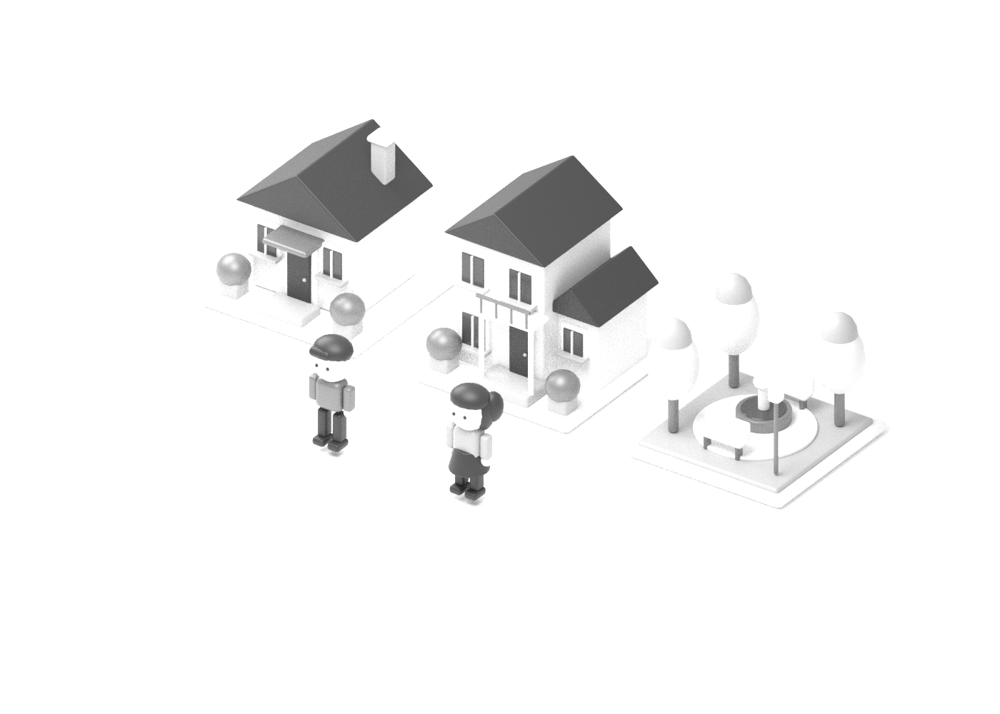

# Little City · 0.8

A phone-first city built with real effort. Finish tasks, study, earn cash, place homes, and watch residents visit the park. White background, monochrome models, transparent 3D canvas, and a permanently visible horizonless grid.

**Play:** https://cyrusvibecoding.github.io/compound/?v=little-city-08



## The first city

New cities start with **$40**, enough for a basic house. Drag a building from the tray onto open ground, or select it and tap the grid. A valid drop buys it. Tap a building to rotate or store it. Layout undo keeps purchased ownership; stored homes pause their residents and rent.

| Building | First price | Residents | Automatic rent |
|---|---:|---:|---:|
| Basic house | $40 | 1 | $2/hour |
| Big house | $120 | 3 | $6/hour |
| Pocket park | $30 | — | — |

Each additional building of the same type costs 20% more, rounded up. Rent is added directly to cash using elapsed time, including while away. No collection button, upkeep, streaks, energy, or missed-day penalties. Moving a home never duplicates rent; placing/storing/undoing settles the previous layout first.

Finishing a task earns **$20 once**. A completed 5/10/25-minute study session pays **$2 per minute**, claimed once. Choosing Finished task adds the task reward if still unfinished. Made progress keeps the task open; Keep going claims the completed session and starts another. Study tracks elapsed timestamps while the phone is locked. Task notes, subtasks, custom projects, Today selection, progress notes, and next-step history remain available.

Boy and girl residents have distinct low-poly models and articulated walking limbs. They walk around houses to park destinations, pause there, and return home. Without a park they take neighborhood walks. Routing uses a bounded grid search only when layouts change; homes and park furniture are obstacles. The visible crowd is capped at 32 for mobile rendering; all placed homes still count for population and rent. Calmer effects and system reduced motion freeze residents and remove spring placement/particles.

This first city release contains homes and a park. Factory skill-tree content is future work. The retired factory upgrade, energy, invention, material, finish, and collection screens have been removed.

## Run

Node 20.19+ or 22.12+:

```sh
npm ci
npm run dev
npm test
npm run build
```

Source is on `main`; GitHub Pages serves the built `dist/` files from `gh-pages`. Keep `.nojekyll` when deploying. The generated service worker versions its cache using the complete build and models. Existing sessions get an update notice.

## Models

Editable Blender sources are in `models/city/`:

- `house.blend`: gabled cottage, stoop, windows, chimney, planters.
- `big-house.blend`: two-storey home, side wing, balcony, porch.
- `park.blend`: fountain, benches, trees, lamp.
- `boy.blend`, `girl.blend`: stylized residents, named shoulder/hip pivots.

Runtime GLBs are in `public/models/`. Rebuild with Blender 4.3+:

```sh
blender -b --python scripts/build_city_models.py
```

Editable sources retain separate objects. Runtime export batches meshes by material/parent: 5–6 meshes per building and 10 per character, each GLB below 250 KB. Models have no large textures, skeleton solver, or physics dependency. Original factory `.blend` files remain as source archives; their GLBs are removed from the app. `scripts/build_factory_models.py` is the archived factory generator, not the city build step.

## Saves and migration

City saves use `compound-city-v1`, with a previous valid snapshot at `compound-city-v1-backup`. The separate key prevents an old factory tab from overwriting the city. Recovery checks city primary, city backup, `compound-v2`, `compound-v2-backup`, and `compound-v1`, in that order.

Old factory saves migrate once:

- Core → basic house; Press → big house; Assembler → park.
- Existing object IDs, placements, rotations, and layout undo remain intact.
- Matter + stored production + Charge become cash. Retired machine upgrades receive cash credits using their former upgrade prices.
- Tasks, subtasks, notes, projects, active study sessions, focus history, and next-step notes stay intact.
- A `legacyFactory` snapshot of the original save stays in city exports. Migration details and the upgrade credit appear in Settings.
- Rent starts at migration, without inventing pre-city earnings.

Settings includes autosave status, manual save, export/import, Calmer effects, How to play, and a confirmed full reset. Reset replaces city and legacy recovery slots with fresh city state so erased progress cannot return through recovery. Export first to keep a copy. Other apps' storage is untouched; failed resets attempt to restore overwritten values. Import updates live state and the page-hide snapshot before another navigation can overwrite it.

Data stays in the browser. Export before changing devices or clearing storage. There is no server sync, notification system, or sound.

## Verification

22 tests cover cash rewards/replay protection, study outcomes, purchases, failed drops, ownership/rotation/layout undo, finite rent accounting and backwards clocks, offline equivalence, resident routes, invalid backups, legacy migration/refunds, save isolation/recovery, reset rollback, import, and GLB size/joint/draw-call budgets.

Mobile Chromium checks at 390 × 844 cover city model loading, resident totals, offline rent, actual tray drag purchases without text selection, task/study cash, the guide, calmer effects, migration, reset cancel/confirm, legacy import, and reload persistence. Physical iPhone 12/Safari gestures, Home Screen behavior, and frame rate remain unmeasured.
