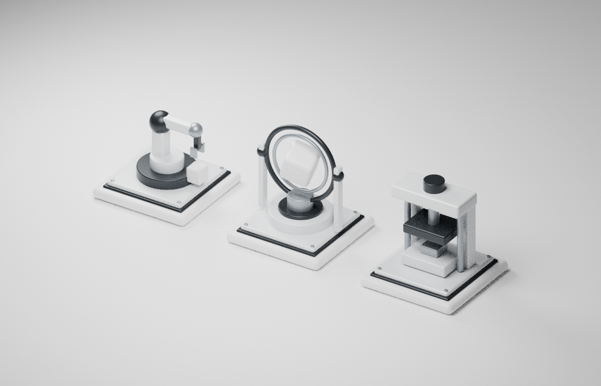

# Compound · motion & milestones 0.4

A phone-first, monochrome productivity game. Real work earns Matter and Charge. Charge powers the miniature farm you build.

**Live app:** https://cyrusvibecoding.github.io/compound/?v=motion-milestones-04



## Run and build

Node 20.19+ or Node 22.12+:

```sh
npm ci
npm run dev
npm test
npm run build
```

`dist/` is the deployable static site. Relative paths support GitHub Pages under `/compound/`. The `gh-pages` branch contains the deployed build; `main` contains source. Changes on `main` need rebuilding and publishing to `gh-pages`.

For iPhone, open the live HTTPS app in Safari and choose Share → Add to Home Screen. Home Screen installation and offline caching require HTTPS. Opening `localhost` on an iPhone does not connect it to a different computer.

## Farm controls

- Drag objects from the tray or directly on the farm. Tap a placed object for upgrades, rotation, or returning it to the tray.
- Tap a tray object then an open map space as an alternative to dragging.
- Placement snaps to half-unit spacing and rejects overlaps. A temporary grid and ghost preview appear while editing.
- Layout undo restores the previous placement/rotation without reversing purchases or production rewards. Machines remain owned after undo.
- Pan empty space, pinch to zoom, or recenter to frame the saved layout.

## Motion and milestones

- Machines spring into position and rotate through the shortest angle. Drops and upgrades create brief ground ripples and a bounded particle burst.
- Curved pale tracks carry small resource blocks while production runs. These tracks visualize the existing factory; they are not editable production connections.
- Collection, task completion and focus outcomes send reward particles to the Matter counter. Task completion gets a brief checkmark pop. Machines gain a subtle selection ring.
- Open the tray's sparkle button for five milestones and their progress. Finishes are visual rewards: Porcelain is available immediately, Graphite unlocks after 3 finished tasks, and Brushed silver after 25 completed focus minutes. Previously earned progress counts automatically.
- Finish selection and the Calmer effects setting save with your existing data. System reduced-motion preferences always take priority. Calmer effects keep production and rewards identical.
- No bloom, screen shake or full-screen flashes. Effects use a small fixed particle budget; the 3D farm unmounts during focus sessions.

## Work and production

- A completed 5/10/25-minute session earns **2 Matter +1 Charge per minute**.
- Completing a task earns **20 Matter +5 Charge**, once. Partial work earns the session reward without marking the task done. Continue claims the completed round and starts a new one.
- Charge rewards fill available tank capacity. Removing capacity does not delete existing Charge; no new Charge is added until space is available.
- Core must be placed to produce. Its three levels store 30/60/90 Charge and yield 1/1.25/1.5 Matter per Charge.
- A placed Press consumes Charge at 1.5/2/2.5 per minute, versus 1 without a Press. More speed produces Matter sooner rather than creating energy.
- A placed Assembler auto-collects output, adds 30 Charge capacity per level, and adds 40 output capacity per level (base output capacity: 20).
- Without auto-collection, output waits in storage. Full storage pauses production without consuming Charge. Tap Collect to bank it.
- Production uses elapsed timestamps, catches up when reopened, and is capped by earned Charge and available output storage. Placing, removing or upgrading settles previous production before changing rates.

Tasks include editable titles, notes, subtasks, custom projects and an explicit Today selection. Focus history includes outcome and optional progress notes. Work is self-reported. No background alarms, sound or notifications are enabled.

## Data and updates

Data stays in this device's `compound-v1` local-storage key. Older saves and exported backups migrate without resetting tasks, Matter, machine ownership, sessions or layout. Export backups in Settings before clearing browser data or switching devices. No sync or server database is configured.

Production builds cache the app and models for offline reopening. Navigation bypasses HTTP cache, updates are checked when returning to the app, and an update notice offers refresh without interrupting a work session. Versioned test links help open a fresh document.

## Blender models

Editable `.blend` files are in `models/`; optimized runtime GLBs are in `public/models/`. Blender 4.3+:

```sh
blender -b --python scripts/build_models.py
blender -b --python scripts/render_models.py
```

The first command regenerates sources and exports. The second creates a showroom scene and PNG preview. Separate moving meshes retain their names. `L2_` and `L3_` objects appear and assemble at matching upgrade levels.

## Verification and limits

TypeScript, production build and 31 unit tests pass. Tests cover reward replay protection, capped online/offline production, storage, upgrades, capacity changes, placement accounting, layout undo, rotation, timer recovery, session outcomes, migration, backup validation, cosmetic gating and spring stability.

Browser automation is unavailable in this environment. Physical iPhone 12 gestures, Safari Home Screen/offline behavior, visual animations and frame rate remain unverified. The design targets 60 fps; it has not been measured. Sound, prestige and more model families remain future work.
